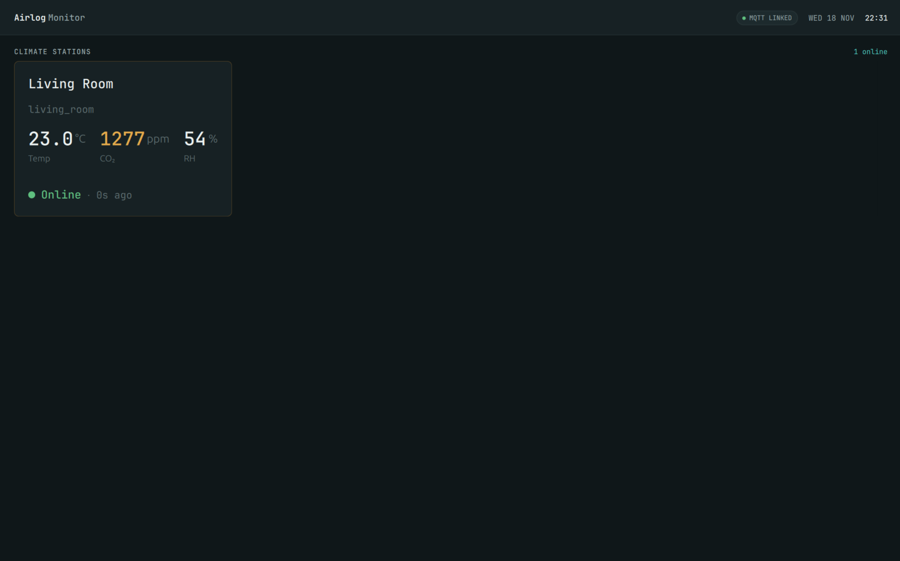
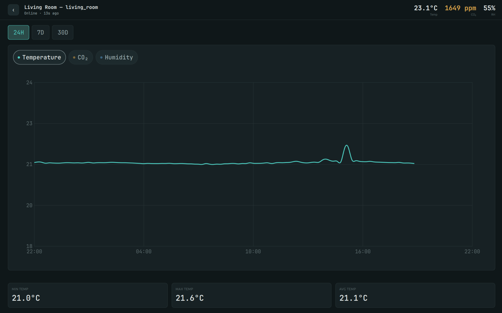

# meta-airlog

Yocto/BitBake layer that builds the **touch-display node** of the
`wakelanaka-airlog` project: a Raspberry Pi 4 running a minimal Linux image
that boots straight into the Qt 6 / QML `dashboard` kiosk app.

The dashboard does not read any sensor itself. Battery-powered ESP32 + SCD41
air nodes publish CO2, temperature and humidity over MQTT to the NAS hub. The
dashboard gets the latest readings per room from the hub's REST API and uses
the MQTT broker to show each station's online/offline status.

Supported Yocto release: **scarthgap** (`LAYERSERIES_COMPAT_meta-airlog`).

---

## 📸 Preview




---

## 🛠️ Hardware

* **Board:** Raspberry Pi 4 Model B (`MACHINE = "raspberrypi4-64"`)
* **Display:** Raspberry Pi Touch Display 2 (DSI-1, rotated 270° in weston)

---

## 📦 Layer contents

| Path | Purpose |
| --- | --- |
| `meta-airlog/recipes-core/images/airlog-image.bb` | The image: `core-image` + weston, Qt 6 (base, declarative, wayland), `airlog`, `i2c-tools` |
| `meta-airlog/recipes-airlog/airlog/airlog_0.1.bb` | Builds the `dashboard` app (`qt6-cmake`) from `git@github.com/wakelanaka-airlog/dashboard.git` (SSH, pinned `SRCREV`) |
| `meta-airlog/recipes-airlog/airlog/files/airlog.service` | systemd unit: waits for the weston Wayland socket, then runs `/usr/bin/dashboard_app` |
| `meta-airlog/recipes-graphics/ttf-jetbrains-mono-nerd-font/` | JetBrains Mono Nerd Font (Mono variant, Regular/SemiBold/Bold only) used by the dashboard |
| `meta-airlog/recipes-graphics/wayland/weston-init.bbappend` | Installs `weston.ini`: kiosk shell (no panel, no lock, no idle), DSI-1 rotation |
| `meta-airlog/recipes-connectivity/wpa-supplicant/` | Uses `wpa_supplicant@wlan0.service` with `/etc/wpa_supplicant/wpa_supplicant-wlan0.conf` |
| `meta-airlog/recipes-core/systemd/` | `systemd-networkd` config: DHCP on `wlan0` |
| `meta-airlog/conf/machine/airlog-extra.inc` | Pulled in by `layer.conf`: enables I2C and UART, VC4 graphics, U-Boot, autoloads `vc4 v3d gpu-sched i2c-dev i2c-bcm2835` |
| `meta-airlog/conf/templates/airlog/` | `TEMPLATECONF` for a new build directory (`bblayers.conf`, `local.conf`) |

---

## 🧩 Dependencies

The layers listed in `meta-airlog/conf/templates/airlog/bblayers.conf.sample`, all on
the `scarthgap` branch unless noted otherwise:

* `poky` (`meta`, `meta-poky`, `meta-yocto-bsp`)
* `meta-openembedded` (`meta-oe`, `meta-python`, `meta-networking`)
* `meta-raspberrypi`
* `meta-qt6` (a Qt 6 LTS branch that supports scarthgap)

The template expects these layers to be **siblings of `poky`**
(`##OEROOT##/../<layer>`), with this repo checked out next to them as
`yocto/`, so the layer is at `##OEROOT##/../yocto/meta-airlog`.

---

## 🚀 Building

### With bitbake-setup

`airlog.conf.json` (repo root, next to `meta-airlog/`) pins all sources for
scarthgap: bitbake `2.8`, `openembedded-core`, `meta-yocto`,
`meta-openembedded`, `meta-raspberrypi` on `scarthgap`, plus `meta-qt6` at tag
`v6.8.9-lts`. It adds `meta-airlog` from the local checkout. Run it with a
recent `bitbake-setup`. It only fetches the sources and writes the build
directory, and the build itself runs on the pinned bitbake 2.8.

```sh
bitbake-setup init /path/to/airlog.conf.json airlog
```

scarthgap has no OE configuration fragments, so the generated
`conf/local.conf` starts **empty**. Add the lines printed in the setup notes
(at least `MACHINE`, `DISTRO` and the systemd settings) before running
`bitbake airlog-image`. `meta-airlog/conf/templates/airlog/local.conf.sample` has the
full reference configuration.

### With poky and TEMPLATECONF

```sh
# Directory layout: poky/, yocto/ (this repo), meta-openembedded/, meta-raspberrypi/, meta-qt6/
cd poky
TEMPLATECONF=$PWD/../yocto/meta-airlog/conf/templates/airlog source oe-init-build-env ../build
bitbake airlog-image
```

The template `local.conf` sets:

* `MACHINE ??= "raspberrypi4-64"`, `DISTRO ?= "poky"`, systemd as init manager
* `DL_DIR` / `SSTATE_DIR` left at their defaults (`downloads/` and
  `sstate-cache/` in the build directory). Set them in `conf/local.conf` or
  `conf/site.conf` to share a cache between builds.
* `EXTRA_IMAGE_FEATURES ?= "debug-tweaks"`, which gives an **empty root
  password**. Use it for development only, never on an image exposed to the
  network.

### Required before the first build

1. **SSH access to the `dashboard` repo:** the `airlog` recipe fetches over
   `git@github.com`, so the build host needs an SSH key with access to it.
2. **Wi-Fi credentials:** create
   `meta-airlog/recipes-connectivity/wpa-supplicant/wpa-supplicant/wpa_supplicant.conf-sane`
   (gitignored, never commit it) with your network block.

### Local dashboard development

For iterative work, use `devtool modify airlog` with an `EXTERNALSRC`
pointing to a local `dashboard` checkout. The recipe's `SRCREV` only matters
for a from-scratch build without a devtool workspace.

---

## ⚙️ On-device configuration

`/etc/airlog/env` ships **empty** (mode `0600`, `CONFFILES`), and
`airlog.service` reads it via `EnvironmentFile=`. Fill it on the device with
the variables documented in `dashboard/.env.example`:

* `MQTT_BROKER_URL`, `MQTT_USERNAME`, `MQTT_PASSWORD`
* `RESTAPI_URL`, `RESTAPI_API_KEY`

Real credentials are never baked into the image.
